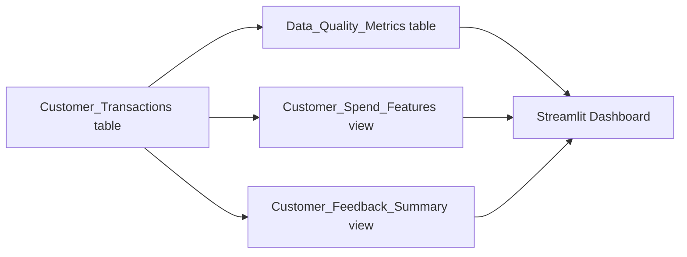

# Enterprise Data Quality Monitor

This project implements an **enterprise-style data quality and reconciliation system** for financial transactions, with support for:

- **Python data pipelines** orchestrating extraction, validation, anomaly detection, reconciliation, and analytics.
- **SQL analytics** via Snowflake or in-memory pandas aggregations.
- **Snowflake integration** using `snowflake-connector-python`.
- **Data validation** (schema, missing values, duplicates, invalid numeric values).
- **Financial reconciliation** between calculated and reported revenue.
- **Anomaly detection** using `IsolationForest`.
- **Data governance & audit-ready reporting** via structured validation outputs.
- **Monitoring dashboard** built with Streamlit and Plotly.

## Project structure

```text
enterprise_data_quality_monitor/
  enterprise_data_quality_monitor/
    __init__.py
    pipeline/
      data_pipeline.py
      extract_from_snowflake.py
    validation/
      schema_validation.py
      missing_values_check.py
      duplicate_detection.py
      anomaly_detection.py
    reconciliation/
      revenue_reconciliation.py
    metrics/
      data_quality_score.py
    warehouse/
      snowflake_client.py
    utils/
      logging_utils.py
      data_utils.py
    dashboard/
      monitoring_dashboard.py
  data/
    financial_transactions.csv
  config/
    snowflake_config.py
  requirements.txt
  README.md
```

## Data validation architecture

The **data pipeline** (in `data_pipeline.py`) orchestrates:

1. **Extraction**
   - From **CSV** via `utils.data_utils.load_transactions_from_csv`.
   - From **Snowflake** via `warehouse.snowflake_client.fetch_transactions` wrapped by `extract_from_snowflake.py`.
2. **Schema validation**
   - `validation.schema_validation.validate_schema` checks that the dataset has the required fields:
     - `transaction_id`, `date`, `customer_id`, `product`, `revenue`, `region`.
   - Returns missing/extra columns and a boolean `is_valid` flag.
3. **Missing values**
   - `validation.missing_values_check.check_missing_values` computes:
     - Overall missing percentage.
     - Per-column missing percentages.
4. **Duplicate detection**
   - `validation.duplicate_detection.detect_duplicates` identifies duplicate rows (by `transaction_id` by default) and returns:
     - Count & percentage of duplicates.
     - A DataFrame of duplicate records for audit.
5. **Anomaly detection**
   - `validation.anomaly_detection.detect_revenue_anomalies` uses **IsolationForest** on revenue (and basic date-derived features) to flag abnormal transactions.
   - Returns anomaly count, anomaly scores, and a DataFrame of anomalous rows.

The pipeline collects all these outputs into a **structured validation payload** that can be logged, exported, or inspected in the dashboard.

## Reconciliation logic

The module `reconciliation/revenue_reconciliation.py` implements:

- `reconcile_revenue(transactions_df, reported_df, tolerance_pct=1.0)`:
  - Computes **calculated revenue** as the sum of the `revenue` column.
  - Computes **reported revenue** by summing the `reported_revenue` column from a summary dataset (CSV or Snowflake).
  - Calculates:
    - Absolute difference.
    - Percentage difference.
    - A `within_tolerance` flag (default tolerance 1%).

This produces an audit-ready dictionary with all reconciliation metrics that is displayed in the dashboard.

## Data quality score

`metrics/data_quality_score.py` defines `compute_data_quality_score`, which:

- Starts from **100 points** and subtracts penalties for:
  - **Missing values** (up to 20 points, linear in missing %).
  - **Duplicates** (up to 15 points, linear in duplicate %).
  - **Schema invalidity** (20 points if required columns are missing).
  - **Anomalies** (up to 25 points based on anomaly ratio).
- Returns:
  - Overall **Dataset Health Score** (0–100).
  - Component metrics (missing %, duplicates %, anomalies, etc.).
  - Penalties for transparency and governance.

Example dashboard output:

```text
Dataset Health Score: 92
Missing Values: 0.5%
Duplicates: 0.2%
Anomalies: 7 records
```

## Snowflake integration

Snowflake integration is implemented via:

- `config/snowflake_config.py`
  - `SnowflakeConfig` dataclass with:
    - `account`, `user`, `password`, `role`, `warehouse`, `database`, `schema`.
  - `SnowflakeConfig.from_env()` to load configuration from environment variables (e.g. `SNOWFLAKE_ACCOUNT`, `SNOWFLAKE_USER`, etc.).
- `warehouse/snowflake_client.py`
  - `snowflake_connection` context manager that opens and closes the Snowflake connection.
  - `fetch_dataframe` for generic queries.
  - `fetch_transactions` and `fetch_reported_revenue` with typed return values for pipeline usage.
- `pipeline/extract_from_snowflake.py`
  - Thin wrappers that call the warehouse client and integrate with the main pipeline.

**Security note:** credentials are never hardcoded; set them using environment variables or a secrets manager before running with Snowflake as a source.

## SQL analytics

The pipeline exposes SQL-style analytics via pandas group-bys:

- `total_revenue`: scalar total of all `revenue` values.
- `daily_revenue`: daily aggregate `revenue` by `date`.
- `revenue_by_region`: total `revenue` per `region`.
- `top_customers`: top N customers by `revenue`.

When running against Snowflake, the same aggregates could be computed directly in SQL instead of pandas; the current implementation keeps analytics in-process for simplicity.

## Streamlit monitoring dashboard

The dashboard in `dashboard/monitoring_dashboard.py` provides:

- **Configuration sidebar**
  - Select **data source**: CSV or Snowflake.
  - For CSV: path to `financial_transactions.csv`.
  - For Snowflake: table names for transactions and optional revenue summary.
- **KPIs**
  - Data Quality Score.
  - Missing values percentage.
  - Duplicates percentage.
  - Number of anomaly records.
  - Total revenue.
- **Data quality views**
  - Missing values by column.
  - Duplicate count and sample duplicate rows.
- **Anomaly alerts**
  - Count of anomalous transactions.
  - Table preview of anomalous records.
- **Reconciliation**
  - Calculated vs reported revenue with absolute and percentage differences.
  - Status flag for within/outside tolerance.
- **Revenue analytics (Plotly)**
  - Daily revenue time series.
  - Revenue by region bar chart.
  - Top customers by revenue bar chart.

### Running the dashboard

## Setup & run

### 1) Create a virtual environment

From the repository root:

```bash
python -m venv .venv
source .venv/bin/activate
python -m pip install --upgrade pip
```

### 2) Install dependencies

Install the project requirements:

   ```bash
   pip install -r enterprise_data_quality_monitor/requirements.txt
   ```

### 3) (Optional) Configure Snowflake credentials

Set these environment variables if you want to run with Snowflake as a source:

   ```bash
   export SNOWFLAKE_ACCOUNT=...
   export SNOWFLAKE_USER=...
   export SNOWFLAKE_PASSWORD=...
   export SNOWFLAKE_ROLE=...
   export SNOWFLAKE_WAREHOUSE=...
   export SNOWFLAKE_DATABASE=...
   export SNOWFLAKE_SCHEMA=...
   ```

### 4) Run the Streamlit dashboard

From the repository root:

   ```bash
   streamlit run enterprise_data_quality_monitor/dashboard/monitoring_dashboard.py
   ```

#### Using the Kaggle "Customer Transactions" dataset

If you downloaded the Kaggle dataset CSV (e.g. `Customer_Transactions.csv`), place it at:

`enterprise_data_quality_monitor/data/Customer_Transactions.csv`

Then in the dashboard, select **CSV** mode and set the path to:

`data/Customer_Transactions.csv`

The pipeline will automatically adapt it into the required schema
(`transaction_id,date,customer_id,product,revenue,region`) using:

- `date` = `last_purchase_date`\n
- `region` = `country`\n
- `revenue` = `num_purchases * avg_purchase_value` (proxy)\n
- `transaction_id` = synthesized per row\n

### 5) Run the pipeline (non-UI)

You can run the pipeline directly from Python for batch or scheduled jobs:

```python
from enterprise_data_quality_monitor import run_pipeline

results = run_pipeline(source="csv", csv_path="data/financial_transactions.csv")

print("Dataset Health Score:", results["data_quality_score"]["score"])
print("Total Revenue:", results["analytics"]["total_revenue"])
```

For Snowflake:

```python
from enterprise_data_quality_monitor.config.snowflake_config import SnowflakeConfig
from enterprise_data_quality_monitor import run_pipeline

config = SnowflakeConfig.from_env()

results = run_pipeline(
    source="snowflake",
    snowflake_config=config,
    snowflake_table="DB.SCHEMA.TRANSACTIONS",
    snowflake_summary_table="DB.SCHEMA.REVENUE_SUMMARY",
)
```

### Troubleshooting

- If you see `ModuleNotFoundError`, make sure you’re running commands from the **repository root** and your virtual environment is activated.\n
- If Snowflake imports fail, confirm `snowflake-connector-python` installed successfully and that your environment variables are set.\n
## Notes

- The included CSV in `data/financial_transactions.csv` is a small synthetic sample for demonstration.
- All modules are designed to be **modular and testable**, similar to production data engineering systems.

---

## Forecasting module

To demonstrate basic **revenue/spend forecasting**, the project includes a simple
moving-average forecaster in:

- `forecasting/simple_forecast.py`

The pipeline:

- Builds a daily revenue/spend series.
- Applies a rolling-window mean over the last 14 days.
- Uses the latest rolling mean as the forecast for the next 7 days.
- Exposes the forecast via `analytics["daily_forecast"]`.

In the dashboard, the **Daily Revenue (Actual vs Forecast)** chart overlays:

- Historical daily totals.
- Forecasted values for the next 7 days.

This keeps the implementation lightweight while still showing forecasting skills
that map directly to revenue / spend analytics.

---

## Deploying to Streamlit Cloud

This repository is structured so you can deploy the dashboard to Streamlit Cloud:

1. Push the project to GitHub.
2. In Streamlit Cloud, create a new app pointing to this repo.
3. When asked for:
   - **Python dependencies file**: select `requirements.txt` at the repo root  
     (it includes `enterprise_data_quality_monitor/requirements.txt`).
   - **Main file**: set

     ```text
     enterprise_data_quality_monitor/dashboard/monitoring_dashboard.py
     ```

4. Configure environment variables in Streamlit Cloud (same as your local `.env`):
   - `SNOWFLAKE_ACCOUNT`
   - `SNOWFLAKE_USER`
   - `SNOWFLAKE_PASSWORD`
   - `SNOWFLAKE_ROLE`
   - `SNOWFLAKE_WAREHOUSE`
   - `SNOWFLAKE_DATABASE`
   - `SNOWFLAKE_SCHEMA`

Once deployed, the app will behave the same as locally, supporting both CSV and
Snowflake sources.

---

## Development, testing, and CI/CD

This project includes a minimal testing and CI-ready structure:

- **Tests**
  - `tests/test_data_quality_score.py` exercises the scoring logic.
  - Run tests locally with:

    ```bash
    pip install -r enterprise_data_quality_monitor/requirements-dev.txt
    pytest enterprise_data_quality_monitor/tests
    ```

- **CI/CD concept**
  - A typical GitHub Actions workflow would:
    - Install dependencies (`requirements.txt` + `requirements-dev.txt`).
    - Run `pytest` and a linter (e.g., `ruff` or `flake8`).
    - Build and optionally deploy the Streamlit app.
  - This repository is structured so such a workflow can be added easily.

---

## Snowflake best practices (conceptual)

The Snowflake usage in this project is designed to reflect common best practices:

- **Warehouse sizing & auto-suspend**
  - Use a dedicated warehouse (e.g., `COMPUTE_WH`) sized for analytics workloads.
  - Enable **auto-suspend** and **auto-resume** to control cost.

- **Schema & objects**
  - Separate raw tables (`CUSTOMER_TRANSACTIONS`) from analytics views:
    - `CUSTOMER_SPEND_FEATURES`
    - `CUSTOMER_FEEDBACK_SUMMARY`
    - `DATA_QUALITY_METRICS`
  - Views provide a stable, governed interface to underlying data.

- **Security & governance**
  - In a real deployment, you would:
    - Create roles for analytics vs operations (e.g., `DATA_ANALYST`, `DATA_ENGINEER`).
    - Grant `SELECT` on views rather than base tables to limit exposure.
    - Use separate roles/warehouses for dev vs prod.

- **Performance**
  - Push aggregations and metrics into Snowflake views and procedures
    instead of computing everything in Python.
  - Consider clustering keys and micro-partitioning for very large tables.

---

## ERP / finance-flavored example

While the project currently uses a Kaggle customer transactions dataset, the same
pipeline pattern can be applied to ERP or finance systems. For example:

- Suppose you have an `ERP_TRANSACTIONS` table with:
  - `TRANSACTION_ID`
  - `TRANSACTION_DATE`
  - `CUSTOMER_ID`
  - `PRODUCT_CODE`
  - `NET_AMOUNT`
  - `REGION`

You can:

- Create a view:

  ```sql
  CREATE OR REPLACE VIEW FINANCE_DB.PUBLIC.FINANCIAL_TRANSACTIONS AS
  SELECT
    TRANSACTION_ID    AS transaction_id,
    TRANSACTION_DATE  AS date,
    CUSTOMER_ID       AS customer_id,
    PRODUCT_CODE      AS product,
    NET_AMOUNT        AS revenue,
    REGION            AS region
  FROM FINANCE_DB.PUBLIC.ERP_TRANSACTIONS;
  ```

- Point the dashboard’s Snowflake source at:

  - `FINANCE_DB.PUBLIC.FINANCIAL_TRANSACTIONS`

and reuse the same validation, anomaly detection, reconciliation, and analytics
without changing Python code.

---

## Snowflake object design diagram

The following diagram summarizes the Snowflake-side flow of data for this project:



This mirrors the end-to-end story:

- Raw data in Snowflake.
- Derived views and metrics for analytics and quality.
- A Python/Streamlit application that surfaces KPIs, anomalies, forecasts, and
  automated metrics for monitoring.


